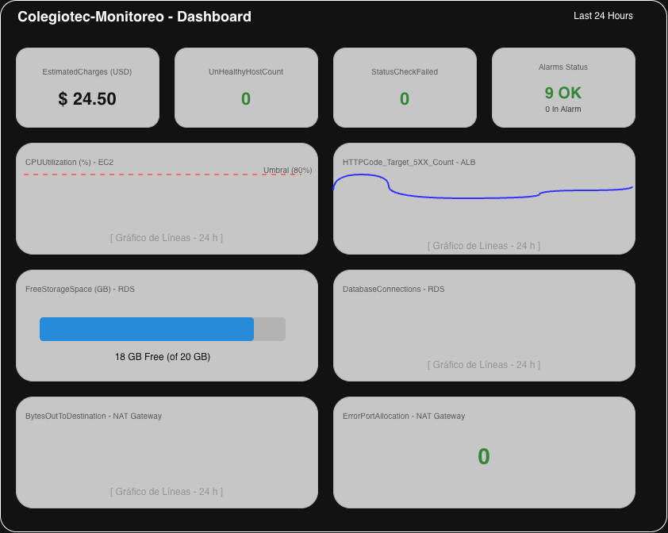

# Pre-entrega 7: Dashboard de Monitoreo, Alertas y Auditoría en AWS

**Curso:** Cloud Computing (AWS)
**Estudiante:** Christian Herrero
**Proyecto:** Plataforma web para estudiantes de un colegio secundario técnico (región `us-east-1`)

---

## Introducción

En esta entrega retomo la arquitectura de las entregas anteriores (VPC del Módulo 6, S3 y EBS del Entregable 4, y RDS del Entregable 5) y diseño cómo la voy a **monitorear** (CloudWatch), cómo me van a **avisar** cuando algo ande mal (alarmas + SNS) y cómo voy a **auditar** los cambios (CloudTrail y AWS Config).

Siguiendo el modelo de responsabilidad compartida que vimos, AWS cuida el hardware y la infraestructura física, pero configurar las alertas y revisar quién cambia qué en mi red es responsabilidad mía.

**Arquitectura de referencia:**
- Route 53 y CloudFront como entrada (DNS y archivos estáticos).
- Application Load Balancer (ALB) en las subredes públicas A y B.
- 2 servidores EC2 t3.micro con Auto Scaling, en subredes privadas de dos zonas de disponibilidad (`SG-WEB`).
- Amazon RDS MySQL principal y standby, en subredes privadas (`SG-RDS`).
- 2 NAT Gateway (uno por zona) para la salida a internet de los servidores privados.
- Amazon S3 con tres buckets: `colegiotec-entregas-prod-use1`, `colegiotec-estaticos-prod-use1` y `colegiotec-logs-prod-use1`.
- SNS y Lambda para el email de bienvenida de nuevos registros.

---

## 1. Identificación de Recursos y Métricas Clave (Amazon CloudWatch)

Revisé mi diagrama de red del Módulo 6 buscando los **puntos de fallo**, es decir, los lugares donde si algo se rompe los estudiantes se quedan sin plataforma. Para garantizar disponibilidad, rendimiento y control de costos, seleccioné los siguientes servicios y métricas:

### 1.1. Amazon EC2 (Servidores Web y Cómputo)
* **`CPUUtilization`:** Permite identificar sobrecarga en los servidores ante picos de tráfico, por ejemplo cerca de las fechas de entrega, cuando muchos estudiantes suben trabajos. Si llega al límite, la página se pone lenta.
* **`StatusCheckFailed`:** Detecta fallas de la instancia, ya sea del sistema operativo o del hardware de AWS, para actuar antes de que los estudiantes noten la caída.

### 1.2. Elastic Load Balancer – ALB (Entrada de la aplicación)
* **`HTTPCode_Target_5XX_Count`:** Cuenta los errores de servidor que la aplicación devuelve a los estudiantes. Es mi indicador de errores de la aplicación.
* **`UnHealthyHostCount`:** Indica cuántos servidores el ALB considera "no sanos". Con solo 2 servidores, perder uno reduce a la mitad la capacidad.

### 1.3. Amazon VPC – NAT Gateway (Red)
* **`ErrorPortAllocation`:** Si el NAT Gateway no puede asignar más conexiones salientes, los servidores privados pierden internet.
* **`BytesOutToDestination`:** Mide los datos que salen hacia internet. Un pico anormal puede indicar un problema o un costo inesperado, porque el NAT Gateway cobra por datos procesados.

### 1.4. Amazon RDS (Base de Datos Relacional)
* **`FreeStorageSpace`:** Alerta sobre la falta de espacio en disco, evitando que la base se bloquee y deje de guardar notas, entregas y estudiantes.
* **`DatabaseConnections`:** Monitorea las conexiones simultáneas para evitar llegar al máximo que soporta la instancia `db.t3.micro`, lo que rechazaría nuevas conexiones.

### 1.5. Facturación Global (AWS Billing)
* **`EstimatedCharges`:** Supervisa los cargos acumulados en dólares durante el mes para evitar sobrecostos inesperados por recursos olvidados o mal configurados.

> **Nota sobre S3:** no le puse alarmas de uso porque S3 crece sin un límite de capacidad y mis buckets ya tienen reglas de ciclo de vida (Entregable 4) que controlan el costo. Lo cubro con la regla de AWS Config para que ningún bucket sea público y con la alarma de facturación.

---

## 2. Matriz de Alarmas y Notificaciones (CloudWatch Alarms + Amazon SNS)

Diseñé una matriz de alarmas que notifica al administrador mediante un tópico de Amazon SNS llamado `alertas-colegiotec`, con una suscripción de correo electrónico a `admin@example.com`.

**Cómo funciona el flujo de alerta:**
1. Creo el tópico SNS `alertas-colegiotec`.
2. Le agrego una suscripción con protocolo **Email** hacia `admin@example.com` y confirmo el link que llega por mail (sin confirmar no llegan las alertas).
3. Cada alarma de CloudWatch usa ese tópico como acción: cuando pasa al estado `ALARM`, CloudWatch publica en el tópico y SNS envía el correo.

Este tópico es distinto al de `nuevo-registro` que ya uso para el email de bienvenida, para no mezclar alertas técnicas con eventos de la aplicación.

Para evitar alarmas "ruidosas", todas usan períodos de 5 minutos (la facturación usa 6 horas, porque esa métrica se actualiza pocas veces por día) y casi todas exigen 2 períodos consecutivos.

| Recurso / Servicio | Métrica de CloudWatch | Condición y Umbral | Período de Evaluación | Acción / Notificación (Amazon SNS) |
| :--- | :--- | :--- | :--- | :--- |
| **EC2 (Web Server)** | `CPUUtilization` | `>= 80%` | 2 períodos consecutivos de 5 min | Tópico SNS `alertas-colegiotec` -> Correo a `admin@example.com` |
| **EC2 (Web Server)** | `StatusCheckFailed` | `>= 1` | 2 períodos consecutivos de 5 min | Tópico SNS `alertas-colegiotec` -> Correo a `admin@example.com` |
| **ALB** | `HTTPCode_Target_5XX_Count` | `> 10 errores` (suma) | 2 períodos consecutivos de 5 min | Tópico SNS `alertas-colegiotec` -> Correo a `admin@example.com` |
| **ALB** | `UnHealthyHostCount` | `>= 1` | 2 períodos consecutivos de 5 min | Tópico SNS `alertas-colegiotec` -> Correo a `admin@example.com` |
| **NAT Gateway (VPC)** | `ErrorPortAllocation` | `> 0` | 1 período de 5 min | Tópico SNS `alertas-colegiotec` -> Correo a `admin@example.com` |
| **NAT Gateway (VPC)** | `BytesOutToDestination` | `> 1 GB` (suma) | 2 períodos consecutivos de 5 min | Tópico SNS `alertas-colegiotec` -> Correo a `admin@example.com` |
| **RDS (Base de Datos)** | `FreeStorageSpace` | `< 3 GB` (15 % de 20 GB asignados) | 2 períodos consecutivos de 5 min | Tópico SNS `alertas-colegiotec` -> Correo a `admin@example.com` |
| **RDS (Base de Datos)** | `DatabaseConnections` | `>= 50 conexiones` | 2 períodos consecutivos de 5 min | Tópico SNS `alertas-colegiotec` -> Correo a `admin@example.com` |
| **Facturación Global** | `EstimatedCharges` | `> 10 USD` | 1 período de 6 horas | Tópico SNS `alertas-colegiotec` -> Correo a `admin@example.com` |

**Justificación de los umbrales:**
* **CPU 80 %:** deja margen para reaccionar antes de que la página se ponga lenta; con 2 períodos evito falsas alarmas por picos cortos.
* **StatusCheckFailed >= 1:** cualquier falla ya es un problema real.
* **5XX > 10:** unos pocos errores sueltos son normales, pero una ráfaga indica un problema en la aplicación.
* **UnHealthyHostCount >= 1:** con 2 servidores, perder uno ya reduce la capacidad a la mitad.
* **ErrorPortAllocation > 0:** en condiciones normales siempre debería ser 0.
* **BytesOutToDestination > 1 GB en 5 min:** es un tráfico saliente fuera de lo normal para un colegio; sirve para detectar problemas y controlar costos.
* **FreeStorageSpace < 3 GB:** es una alarma preventiva (queda 15 % libre) para ampliar el disco antes de que se llene.
* **DatabaseConnections >= 50:** aviso antes de llegar al máximo de la instancia pequeña.
* **EstimatedCharges > 10 USD:** presupuesto acorde a un proyecto de curso; si se pasa, hay algo corriendo que no debería.

---

## 3. Mock-up y Organización del Dashboard en CloudWatch

El panel centralizado se llama `Colegiotec-Monitoreo` y muestra las últimas 24 horas. Organiza la información en cuatro filas, de lo más importante (arriba) al detalle (abajo), para ver de un solo vistazo la salud de la plataforma.

### Distribución de Widgets:

* **Fila 1 (Nivel Ejecutivo y Costos):**
  * *Widget 1 (Número simple):* Gasto acumulado del mes (`EstimatedCharges` en USD).
  * *Widget 2 (Número simple):* Servidores no sanos según el ALB (`UnHealthyHostCount`).
  * *Widget 3 (Número simple):* Fallas de las instancias EC2 (`StatusCheckFailed`).
  * *Widget 4 (Estado de alarmas):* Semáforo verde / rojo con el estado general de las alertas configuradas (`Alarms Status`).

* **Fila 2 (Capa de Cómputo y Aplicación - EC2 + ALB):**
  * *Widget 5 (Gráfico de líneas temporal, 24 h):* Porcentaje de uso de CPU (`CPUUtilization`) de las instancias web.
  * *Widget 6 (Gráfico de líneas temporal, 24 h):* Errores de servidor de la aplicación devueltos por el balanceador (`HTTPCode_Target_5XX_Count`).

* **Fila 3 (Capa de Base de Datos RDS):**
  * *Widget 7 (Gauge / Barra de progreso):* Espacio libre en disco disponible (`FreeStorageSpace` en GB), que muestra el consumo de almacenamiento.
  * *Widget 8 (Gráfico de líneas temporal, 24 h):* Conexiones activas a la base de datos (`DatabaseConnections`) a lo largo del tiempo.

* **Fila 4 (Capa de Red - VPC / NAT Gateway):**
  * *Widget 9 (Gráfico de líneas temporal, 24 h):* Datos que salen a internet a través del NAT Gateway (`BytesOutToDestination`).
  * *Widget 10 (Número simple):* Errores de asignación de puertos para salida a internet en el NAT Gateway (`ErrorPortAllocation`).

---

## 4. Plan de Auditoría y Cumplimiento (AWS Config y CloudTrail)

El objetivo es que todos los cambios en la infraestructura queden registrados y poder saber quién cambió qué, cuándo y desde dónde.

### 4.1. Reglas Administradas de AWS Config
Activo el registro de AWS Config, guardando en el bucket `colegiotec-logs-prod-use1` (prefijo `config/`), y agrego estas reglas:

1. **`s3-bucket-public-read-prohibited`:** Alerta si algún bucket S3 tiene lectura pública habilitada. Mis buckets guardan entregas de estudiantes, que son datos de menores, y ninguno debe ser público.
2. **`restricted-ssh`:** Comprueba que ningún Security Group tenga el puerto 22 (SSH) abierto a todo Internet (`0.0.0.0/0`). Mis servidores están en subredes privadas y no deberían ser accesibles desde afuera.
3. **`rds-instance-public-access-check`:** Verifica que la base de datos RDS no sea accesible públicamente. En el Entregable 5 definí que RDS vive en subredes privadas y que solo las EC2 se conectan a ella; esta regla controla que eso se cumpla.

### 4.2. Configuración de CloudTrail y Evento Crítico
* **Configuración:** creo un trail llamado `colegiotec-trail` que registra los eventos de administración de todas las regiones y los guarda en `colegiotec-logs-prod-use1` (prefijo `cloudtrail/`). Así aprovecho las reglas de ciclo de vida del Entregable 4 (pasan a Glacier a los 90 días y se eliminan al año).
* **Evento Monitoreado:** `AuthorizeSecurityGroupIngress` (y también `DeleteVpc`).
* **Justificación y Acción:** `AuthorizeSecurityGroupIngress` registra cuando alguien agrega una regla de entrada a un Security Group (`SG-ALB`, `SG-WEB` o `SG-RDS`). Si se abre, por ejemplo, el puerto 22 o el 3306 (MySQL) a todo internet, la plataforma o la base quedan expuestas. CloudTrail me muestra qué usuario lo hizo, desde qué IP y a qué hora, y la alerta llega por el mismo tópico SNS `alertas-colegiotec` a `admin@example.com`. `DeleteVpc` me avisaría si alguien intenta borrar la red completa.

**Cómo se complementan:** CloudTrail dice quién hizo un cambio (registro histórico) y AWS Config dice si el resultado cumple las reglas (estado actual). Por ejemplo, si alguien abre el puerto 22 en `SG-WEB`, CloudTrail registra `AuthorizeSecurityGroupIngress` con el usuario y la IP, y AWS Config marca el Security Group como no conforme en `restricted-ssh`.

---

## 5. Consistencia con las entregas anteriores

| Entrega anterior | Cómo se relaciona |
| :--- | :--- |
| Entregable 2 (IAM) | Principio de mínimo privilegio: solo el administrador puede modificar alarmas, tópicos y reglas de auditoría. |
| Módulo 6 (VPC) | Las métricas salen de los puntos de fallo del diagrama: ALB, EC2, NAT Gateway A y B, RDS. CloudTrail vigila los Security Groups `SG-ALB`, `SG-WEB` y `SG-RDS`. |
| Entregable 4 (S3 y EBS) | CloudTrail y AWS Config guardan sus registros en el bucket de logs, con las reglas de ciclo de vida ya definidas. |
| Entregable 5 (RDS) | Monitoreo del espacio y las conexiones de RDS, y regla de Config para que siga privada. |

---

## Conclusión

Con este plan cubro las tres necesidades de un administrador: **ver** el estado de la plataforma (dashboard), **enterarme a tiempo** de problemas y gastos (9 alarmas con aviso por SNS a `admin@example.com`) y **auditar** los cambios de la infraestructura (CloudTrail y AWS Config). Las alarmas son preventivas y con períodos de al menos 5 minutos para evitar el ruido, y la alarma de `EstimatedCharges` cuida el presupuesto del proyecto.
